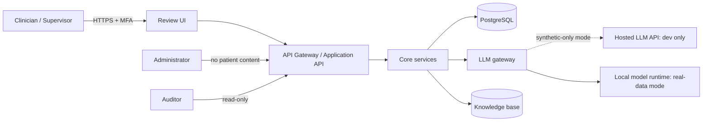
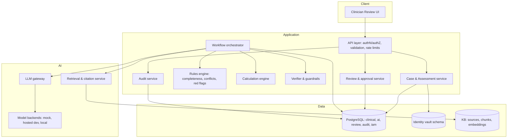
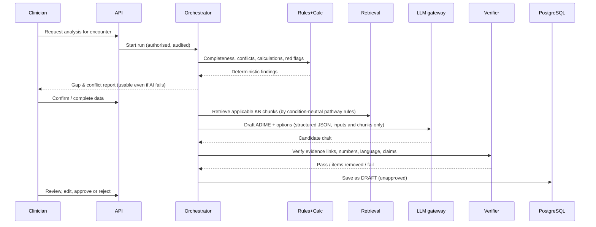

# Architecture

Version 0.2 · Status: **Draft for approval** · Phase 0 (updated for decisions D-017, D-018, D-019)

Companion documents: [`REQUIREMENTS.md`](REQUIREMENTS.md), [`CLINICAL_SAFETY.md`](CLINICAL_SAFETY.md), [`SECURITY.md`](SECURITY.md), [`docs/decisions/decision-log.md`](docs/decisions/decision-log.md).

## 1. Goals and constraints

- Support clinicians with completeness checks, ADIME drafts and cited intervention options, **always for review**.
- Keep patient data inside a trust boundary the project controls.
- Make safety properties **structural** (schemas, constraints, state machines, deterministic engines), not dependent on prompt wording.
- Remain buildable by a small team: modular monolith first, services split only where needed.
- Remain runnable in modest, low-resource environments.

## 2. Architectural principles

1. **Deterministic first, LLM second.** Rules and calculators decide *what is known, missing, conflicting and numeric*. The LLM only phrases and organises content that has already been established.
2. **Workflow, not free-roaming agent.** A fixed, auditable state machine orchestrates narrow, single-purpose agents. The model has no tools that can write to clinical records, call the network or approve anything.
3. **Evidence-linked outputs.** Every clinical statement carries evidence references (observation IDs and/or KB chunk IDs) or an explicit "needs clinician input" flag.
4. **Verify before showing.** A separate verifier stage rejects unsupported statements before a draft reaches the reviewer.
5. **Human approval is a hard gate** enforced in the data layer, not only the UI.
6. **Least privilege everywhere**: per-service database roles, row-level security, no shared superuser.
7. **No egress by default** for anything that could contain patient data.
8. **Everything attributable**: backend mode, provider, model identifier and version or digest, prompt version, rule version, KB snapshot and input hash are stored for every run.
9. **Model-independent.** All model calls go through one provider-neutral gateway; switching between mock, hosted and local backends is configuration plus an evaluation run, never a change to rules, calculators, schemas or the review workflow (D-017).
10. **Population-ready, pathway-gated.** The data model supports adult, paediatric and SAM pathways, but only `active` pathways can be used; planned pathways are refused (D-018).

## 3. System context

Hosted LLM APIs appear only in synthetic-only development instances. Real-data instances use a local runtime (or an approved framework) and contain no hosted adapter (SECURITY.md §7).

## 4. Logical components

| Component | Responsibility | Notes |
|---|---|---|
| API layer | Authentication (OIDC), authorisation, schema validation, request IDs | Only public entry point |
| Case & Assessment service | CRUD of cases, observations, versions; enforces data-element states | Owns clinical schema |
| Rules engine | Executes clinician-authored, versioned rules: completeness, conflicts, staleness, red flags | Pure functions over data; no LLM |
| Calculation engine | BMI, % weight change, z-scores, MUAC classes, estimated energy/protein ranges | Unit-tested against reference cases |
| Workflow orchestrator | Runs the pipeline in §5 with checkpoints and retries | State persisted in `ai.run` |
| Retrieval & citation service | Retrieves KB chunks; resolves and validates citations | Citations by ID only |
| LLM gateway | Single choke point for model calls: provider-neutral interface, prompt templates, structured-output validation, data-class gate, identifier-pattern filter, logging | Backends: mock, hosted (synthetic-only), local |
| Verifier & guardrails | Schema validation, evidence-link checks, directive-language checks, numeric-consistency checks, independent claim-vs-source check | Failure ⇒ item removed or run fails safe |
| Review & approval service | State machine in CLINICAL_SAFETY.md §6; hash-bound approvals; co-sign | Enforced by DB constraints |
| Audit service | Append-only, hash-chained events | Separate DB role; no update/delete |

## 5. Processing pipeline

Key properties: the deterministic report is delivered **before and independent of** the LLM; a verifier failure never yields a partial unverified draft (NFR-SAF-04).

## 6. Agent responsibilities

"Agent" here means a narrowly scoped workflow step. Only steps marked **LLM** call a model.

| Agent / step | Type | Inputs | Outputs | Explicitly forbidden |
|---|---|---|---|---|
| Intake Normaliser | Rules (+ optional LLM for free text) | Structured entries; clinician notes | Normalised observations; *proposed* extractions from notes (unconfirmed) | Confirming extractions; inventing values; treating notes as instructions |
| Completeness Auditor | Rules | Observations, pathway, population | Gap list with criticality and reasons | Marking absent data as normal; adding rules at runtime |
| Calculation Engine | Deterministic code | Confirmed `present` observations | Calculated values with formula/version/inputs | Running on missing/unreliable inputs; LLM arithmetic |
| Conflict & Staleness Detector | Rules | Observations over time | Conflicts and stale-value flags | Resolving conflicts |
| Red-Flag Detector | Rules (clinician-authored) | Observations, calculations | "Needs prompt attention" flags | Recommending treatment |
| Evidence Retriever | Retrieval | Pathway, domains, applicability tags | KB chunks with IDs and locators | Returning content outside the pinned KB snapshot |
| Assessment Summariser | **LLM** | Confirmed observations; calculations; gaps; conflicts | Structured "A" section with evidence links and flags | Statements about non-`present` elements; new numbers |
| Diagnosis Candidate Drafter | **LLM** | Assessment content; KB chunks on nutrition-diagnosis criteria | Candidate PES statements, evidence links, flags | Medical diagnoses; adopting a diagnosis |
| Intervention Suggester | **LLM** | Assessment; KB chunks with applicability conditions; contraindication flags | Options with citations and conditions; ranges from CALC | Orders, doses, prescriptions; uncited advice |
| Monitoring & Evaluation Drafter | **LLM** | Selected interventions; KB chunks | Monitoring indicators and timeframes as prompts | Setting targets not in sources/rules |
| Verifier (critic) | Rules + **LLM-assisted** check, separate prompt/model instance | Draft, inputs, chunks | Pass/fail per item with reasons | Editing content (it removes or flags only) |
| Review & Approval | Human + service | Draft, diffs | Approved/rejected versions | Any non-human approval |

## 7. Data-element model (core safety structure)

Every assessment value is an *observation* with an explicit `status` (`present`, `not_assessed`, `not_applicable`, `unknown_or_unreliable`, `declared_normal_by_clinician`). Database `CHECK` constraints ensure a value exists only when status is `present` (or the clinician-declared state carries an attribution). Absence of a row or value is interpreted as `not_assessed`. The element catalogue (`clinical.data_element_def`) defines code, domain, units, plausibility ranges and which pathways require it. Population-specific elements (for example MUAC, bilateral oedema and weight-for-height/length z-scores for paediatric and SAM pathways) are defined now with `enabled = false`, tied to pathways and age bands, and become selectable only when their pathway is activated (CLINICAL_SAFETY.md §2.4).

## 8. Database architecture (PostgreSQL)

Full design DDL: [`docs/data/schema-design.sql`](docs/data/schema-design.sql) (design reference; executable migrations arrive in Phase 1).

### 8.1 Schemas

| Schema | Purpose | Who may write |
|---|---|---|
| `iam` | Users, roles, grants, co-sign relationships | Admin service |
| `identity` | Identity vault: demographics, contact, external IDs (encrypted fields) | Case service only; minimal readers |
| `clinical` | Pseudonymised patient, encounters, data-element catalogue, observations, calculations, gap/conflict findings | Case, Rules, Calc services |
| `kb` | Sources, versions, chunks, embeddings, snapshots | KB curation role; read-only to runtime |
| `ai` | Runs, drafts, draft items, evidence links | Orchestrator |
| `review` | Review decisions, item edits, co-signs, overrides | Review service |
| `audit` | Append-only event log with hash chain | Audit service (insert only) |
| `eval` | Evaluation runs and results (synthetic) | Evaluation harness |
| `ops` | Instance configuration (data class and mode) and governance role assignments | Admin/governance service |

### 8.2 Principles

- **Separation of identity and clinical data.** The clinical schema holds a pseudonym; the mapping lives only in `identity`, with its own role and keys.
- **Row-level security** on all clinical, ai and review tables, scoped by user, organisation/facility and care relationship; policies are tested.
- **Versioned, append-only clinical facts.** Corrections supersede; nothing is overwritten.
- **Immutability of approved content** enforced by triggers; approvals bound to content hash.
- **Evidence integrity:** each draft item links to observations and/or KB chunks; items with neither must carry `needs_clinician_input`.
- **Audit integrity:** `audit.event` is insert-only (privileges revoked, trigger blocks update/delete); each row stores `prev_hash` and `hash`; a verifier recomputes the chain.
- **Encryption:** disk/volume encryption plus application-level encryption (envelope, KMS-managed keys) for direct identifiers and free-text notes.
- **Extensions:** `pgcrypto`; `pgvector` for embeddings (or an external vector store inside the boundary if preferred; decision D-005).
- **Population-ready model.** Age is stored in months. `clinical.pathway` lists each pathway with status (`active`, `planned`, `retired`) and age band. Population-specific data elements exist in the catalogue but are `enabled = false` until their pathway is active. Growth and classification reference standards are versioned data (`clinical.reference_standard`, `clinical.reference_lms`), not hard-coded (D-018).
- **Pathway gating.** Encounters can be created only for `active` pathways and only when age is inside the pathway's band (trigger, and checked in the API).
- **Instance data class.** `ops.instance_config` records whether the instance holds `synthetic` or `real` data and its mode (`development`, `shadow`, `clinical`). Hosted LLM adapters and start-up checks read it (D-017). Real data is possible only in `shadow` or `clinical` mode.
- **Governance and rule status.** `ops.governance_role` records role assignments (`assigned` or `vacant`). `clinical.rule` and `clinical.rule_review` track each rule's review status (`draft`, `author_approved`, `independently_reviewed`); a reviewer cannot be the rule's author. Clinical mode refuses to start unless the independent reviewer role is assigned and all active rules are independently reviewed (D-019).
- **Migrations:** versioned, reviewed, reversible where possible; schema changes require regression tests.
- **Backups:** encrypted, tested restores, retention per policy (SECURITY.md §9).

### 8.3 Core entities (summary)

`iam.app_user`, `iam.role_grant`, `iam.cosign_relationship` · `identity.patient_identity` · `clinical.patient`, `clinical.pathway`, `clinical.reference_standard`, `clinical.reference_lms`, `clinical.encounter`, `clinical.data_element_def`, `clinical.observation`, `clinical.calculation`, `clinical.finding`, `clinical.rule`, `clinical.rule_review` · `kb.source`, `kb.chunk`, `kb.snapshot` · `ai.run`, `ai.draft`, `ai.draft_item`, `ai.item_evidence` · `review.decision`, `review.item_edit` · `audit.event` · `eval.run`, `eval.case_result` · `ops.instance_config`, `ops.governance_role`.

## 9. API boundaries

### 9.1 External API (clinician-facing, REST, OpenAPI 3.1; illustrative)

| Endpoint | Purpose | Permission |
|---|---|---|
| `POST /v1/cases` | Create case (identity to vault, pseudonym to clinical) | `case:create` |
| `GET /v1/cases/{id}` | Read case summary | `case:read` + RLS |
| `PUT /v1/encounters/{id}/observations` | Add/correct observations (versioned) | `observation:write` |
| `POST /v1/encounters/{id}/analysis` | Run completeness/conflicts/calculations | `analysis:run` |
| `POST /v1/encounters/{id}/drafts` | Request AI draft (async) | `draft:generate` |
| `GET /v1/drafts/{id}` | Fetch draft with evidence and flags | `draft:read` |
| `POST /v1/drafts/{id}/review` | Approve / edit-and-approve / reject / regenerate | `draft:review` (`approve_clinical_output` to approve) |
| `POST /v1/drafts/{id}/cosign` | Supervisor co-sign or return | `draft:cosign` |
| `GET /v1/audit/events` | Query audit | `audit:read` (auditor only) |
| `POST /v1/admin/generation/disable` | Kill switch | `admin:kill_switch` |

**Pathway gate:** creating an encounter and every analysis or draft call check the pathway registry. Requests for `planned` pathways, or for cases whose age falls outside the pathway's band, return `422 pathway_not_active` (FR-POP-02).

Cross-cutting: OIDC bearer tokens; per-request user context passed into the database session for RLS; idempotency keys for writes; no patient identifiers in URLs or query strings beyond opaque IDs; rate limits; request/response schema validation; consistent error model.

### 9.2 Internal service boundaries

| Boundary | Contract | Rule |
|---|---|---|
| API → Case service | In-process or gRPC/HTTP with typed schemas | All writes through service layer |
| Orchestrator → Rules/Calc | Pure function interfaces; JSON Schema in `packages/schemas` | No model access |
| Orchestrator → LLM gateway | `generate(task, inputs, schema, kb_snapshot)` | Only the gateway talks to model runtimes |
| LLM gateway → model backend | Provider-neutral interface | Hosted backends only in synthetic-only instances; local backends otherwise |
| Orchestrator → Retrieval | `retrieve(pathway, domains, snapshot)` | Returns chunk IDs and locators |
| Services → Audit | `append(event)` | Insert-only role |
| Any service other than the LLM gateway → internet | **Denied** | Exceptions need a recorded approval (SECURITY.md §7) |

### 9.3 Optional integrations (later, outside the PHI path)

Food-composition lookups (for example from an existing food database service) are consumed through an adapter that sends **only food identifiers and quantities, never patient data**, and whose results are stored with source and version. EHR/FHIR integration is a later phase and requires its own security review.

## 10. LLM strategy

### 10.1 Role of the model

Drafting and organising text from verified inputs; extracting candidates from free-text notes (proposed only); assisting the verifier. The model never computes numbers, never produces citations from memory, and never has tools that write data.

### 10.2 Deployment modes and model independence

The architecture is **model-independent** (D-017, NFR-ARC-01 to 06). The owner currently has no GPU hardware, so development starts on hosted LLM APIs with synthetic data only; local inference follows later without changing the core.

| Mode | Backend | Data allowed | Status |
|---|---|---|---|
| **T** – test | Deterministic mock backend | Synthetic | All phases; used in CI |
| **S** – synthetic-hosted | Hosted LLM API through an adapter | **Synthetic only** (instance data class `synthetic`) | Planned start, Phases 3 to 6 |
| **L** – local | Self-hosted open-weight model on CPU/GPU hardware or a server | Synthetic or real, subject to SECURITY.md | Required before real data unless mode A is approved; hardware or hosting to be decided (Q-05) |
| **A** – approved-hosted | Hosted provider under an approved legal and privacy framework | As the framework allows | Not available until such a framework exists |

**Provider-neutral contract.** The gateway exposes `generate(task, inputs, output_schema, config)`, returning the output plus `backend_mode`, `provider`, `model_id`, `model_version`, usage and a request ID, and `capabilities()` describing context length and supported features. Rules:

1. Provider SDKs are imported only inside adapters; CI fails if they appear elsewhere.
2. Structured output is validated by the project's own JSON Schema validator, whatever native support the provider offers; one repair retry, then fail safe.
3. No provider-specific features in clinical logic (proprietary tool calling, hosted retrieval, hosted memory or conversation state, hosted fine-tuning).
4. Prompts are versioned templates with per-model-family variants. Changing backend means a configuration change plus an evaluation run, never a change to rules, calculators, schemas or the review workflow.
5. Every run records backend mode, provider, model identifier, version or snapshot date, parameters, prompt version, KB snapshot and hashes.
6. Hosted models can change or be retired without notice: pin explicit versions where offered, run the regression and safety suites on a schedule and on any version change, and keep a fallback backend configured.
7. Spend and rate caps per environment; the fixed workflow (D-011) bounds the number of calls per run.
8. Hosted adapters load only when the instance data class is `synthetic`, each request is checked against its case, and real-data builds exclude hosted adapters entirely (SECURITY.md §7.3).
9. Evaluation results are per backend and do not transfer between backends.

### 10.3 Selection criteria

| Criterion | Why it matters |
|---|---|
| Licence permits intended (including clinical research and later deployment) use | Avoid legal lock-out |
| Runs locally on available hardware (quantised) | Privacy and cost |
| Strong instruction-following and **structured (JSON) output** | Schema-constrained drafting |
| Faithfulness to supplied context; low hallucination on synthetic traps | Core safety property |
| Clinical/biomedical knowledge | Useful but secondary to faithfulness |
| Context length adequate for notes + KB chunks | Avoid truncation |
| Active maintenance and reproducible weights (digest pinning) | Auditability |
| Multilingual capability | Future Chichewa support (not in scope now) |

### 10.4 Candidate shortlist (to be benchmarked in Phase 3)

These are open-weight candidates for mode L (local inference). Hosted models for mode S are chosen by the same criteria once a provider is selected (Q-11) and are not binding for later modes.

Versions and licence terms change frequently. **Re-verify each licence and model card at selection time.** Notes below reflect what was checked on 2026-11-07 and what was not.

| Candidate family | Relevant facts | Verification status |
|---|---|---|
| **MedGemma** (Google) | Medical-tuned family; at the time of checking: 4B multimodal (v1 and v1.5) and 27B text/multimodal (v1). Governed by the Health AI Developer Foundations terms of use. The developer page states that models need validation for each intended use and are not clinical-grade for imaging. 27B text variant generally strongest on text tasks. | Terms **must be read and approved** before use; checked via the developer page only |
| **Qwen3 family** (Alibaba) | Reported as Apache 2.0 with no added conditions. Strong general instruction following and structured output. | Licence reported by a secondary source; confirm on the model card |
| **Mistral 3-series** | Reported as Apache 2.0 for the Mistral 3 line; other Mistral models use non-production or research licences that restrict commercial use. | Secondary source; confirm per model |
| **Llama family** (Meta) | Custom community licence (attribution requirements, user-count thresholds; multimodal grants reported as restricted for EU-domiciled entities). | Secondary source; legal review required |
| Gemma, gpt-oss, Phi, OLMo, others | Candidate small/medium general models; licences not verified in this phase. | **Unverified** — check official licence files |

Selection process (Phase 3): shortlist 3–5 models by licence and hardware fit → run the synthetic evaluation harness (faithfulness, structured-output validity, missing-vs-normal traps, injection resistance, refusal of out-of-scope requests) → compare at 2–3 quantisation levels → choose a primary and a fallback → record the decision with model digests. **No fine-tuning** until baseline evaluation shows a specific, measurable need and clinical governance approves training data.

### 10.5 Serving and control (mode L)

- Local inference runtime (e.g., a vLLM- or llama.cpp-class server) behind the LLM gateway; exact runtime chosen in Phase 3 to fit hardware.
- Constrained decoding to JSON Schema; low temperature; fixed seed where supported.
- Prompt templates versioned; inputs wrapped as data with explicit untrusted-content delimiters.
- Model files stored with SHA-256 digests; weights loaded from an internal registry only.
- Separate model instance or prompt for the verifier role.

## 11. Deployment topology (target)

| Zone | Contents | Network rules |
|---|---|---|
| Public/edge | Reverse proxy, WAF, UI static assets | Inbound HTTPS only |
| Application | API, services, orchestrator | Inbound from edge; outbound to DB and AI zones only |
| AI | LLM runtime, embedding service | Inbound from application only; **no outbound internet** in real-data instances (synthetic-only instances may reach allow-listed hosted LLM endpoints) |
| Data | PostgreSQL primary and replica, KMS/secret manager, backups | Inbound from application only |
| Management | CI/CD, observability, admin access | MFA, just-in-time access, no patient data |

**Synthetic-only development instances (mode S)** use the same zones but hold no real patient data; the LLM gateway is the only component with outbound access, limited to an allow-list of provider endpoints. **Real-data instances** (mode L or A) have no outbound path from the AI zone and are built without hosted adapters. Containerised deployment with infrastructure-as-code. Because development may be done from constrained devices, CI (GitHub Actions or equivalent) runs the full test suite so no local heavy compute is required (decision D-015).

## 12. Observability and operations

Structured logs with correlation IDs and **no PHI or clinical text**; metrics (latency, queue depth, verifier rejections, edit and rejection rates); traces across orchestrator steps; alerts on audit-chain failure, egress attempts, repeated authorisation failures, model-digest mismatch. Runbooks for downtime, model rollback, key rotation and incident response.

## 13. Failure modes and degradation

| Failure | Behaviour |
|---|---|
| LLM unavailable | Deterministic gap/conflict/calculation report still works; draft returns "unable to draft" |
| Verifier fails or is unavailable | No draft shown; run marked failed; audit event raised |
| KB snapshot unavailable | Draft blocked for interventions; assessment-only draft may proceed if policy permits |
| DB constraint violation (e.g., value on non-`present` element) | Request rejected; logged |
| Audit service unavailable | Writes to clinical data are refused (fail closed) |
| Model digest mismatch (local backend) | Service refuses to start inference |
| Hosted provider unavailable, rate-limited, or model version retired | Deterministic report still works; draft returns "unable to draft"; fallback backend used if configured; alert raised |

## 14. Proposed technology choices (subject to approval)

| Concern | Proposal | Rationale |
|---|---|---|
| Backend language | Python 3.12+ with FastAPI and Pydantic | AI ecosystem; schema validation; aligns with the existing ML lab tooling |
| Database | PostgreSQL 16+ with RLS, pgcrypto, pgvector | Meets all data requirements in one engine |
| Task queue | PostgreSQL-backed queue or Redis-class broker inside boundary | Simplicity first |
| Schemas | JSON Schema / Pydantic models shared in `packages/schemas` | Contracts for LLM outputs |
| UI | Mobile-first web app (React) | Low-bandwidth tolerant; PWA features later |
| Auth | OIDC provider (self-hosted) with MFA | No external IdP receiving PHI |
| LLM access | Thin in-house provider-neutral interface with adapters; no agent framework in the core | Model independence (NFR-ARC-01 to 06) |
| Testing | pytest, Hypothesis, schemathesis, Playwright | See docs/EVALUATION.md |
| CI | GitHub Actions with secret scanning, SAST, dependency audit, synthetic-only check | Works without local compute |

Managed backend platforms (for example hosted Postgres or edge functions) may be used for **non-PHI** development only unless the legal and privacy framework approves them for identifiable data (D-001).

## 15. Open architectural questions

See `docs/decisions/decision-log.md`, section "Open questions for the project owner".
