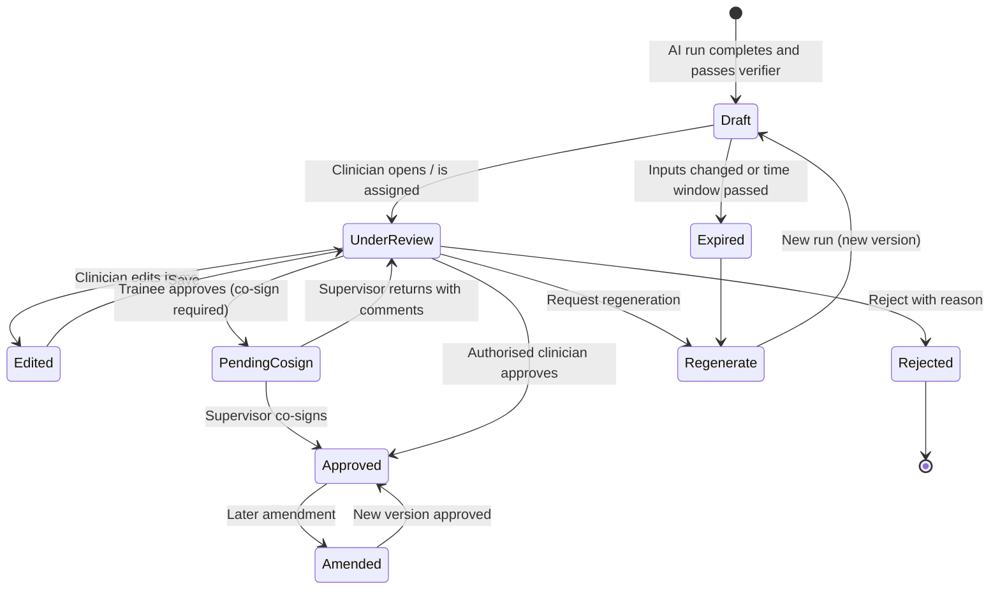

# Clinical Safety

Version 0.1 · Status: **Draft for approval** · Phase 0

This document defines the intended use, clinical scope and limits of the system, the hazard analysis, how each safety rule is enforced, and the human-in-the-loop approval workflow. It is a design document, not a regulatory submission. A named **clinical safety lead** must own it; until one is appointed this document is unapproved.

## 1. Intended use

**Intended purpose.** To assist a qualified nutrition clinician by (a) identifying missing and conflicting information in a nutrition assessment, (b) drafting ADIME documentation, and (c) presenting evidence-referenced intervention options, **all for clinician review**.

**Intended users.** Registered dietitians and nutrition clinicians; trainees only under supervision with co-signature.

**Not intended for.** Use by patients or the public; replacing clinical judgement; autonomous charting; emergency or time-critical decisions; any decision made without clinician review.

## 2. Clinical scope

### 2.1 In scope (initial)

| Area | Detail |
|---|---|
| Populations | To be confirmed by the clinical lead (see decision-log Q-01). Proposed start: **adult inpatient/outpatient** nutrition assessment. Paediatric growth and acute malnutrition pathways (high relevance in sub-Saharan settings) are a **separate, later scope increment** because they require growth standards, different thresholds and dedicated validation. |
| Assessment domains | Anthropometry; biochemical data; clinical and nutrition-focused physical findings; food/nutrient intake and history; functional status; medications and supplements (as reported); relevant history; social and food-access context. |
| Outputs | Completeness report; conflict report; ADIME draft with candidate nutrition diagnoses (PES); intervention options with citations; monitoring and evaluation prompts. |

### 2.2 Out of scope

- Medical diagnosis (e.g., diagnosing diabetes, renal failure, HIV-related conditions).
- Prescription of drugs, therapeutic diets, enteral or parenteral formulas, or doses.
- Emergency triage and acute resuscitation decisions.
- Interpretation of images (e.g., photographs, imaging).
- Patient-facing advice.
- Pregnancy/lactation, critical care, inborn errors of metabolism, oncology-specific protocols, and eating-disorder treatment planning: **excluded until explicitly added** with specialist clinical review and dedicated tests.

### 2.3 Nutrition diagnosis vs. medical diagnosis

In the nutrition care process, a *nutrition diagnosis* names a nutrition problem the dietitian is responsible for treating. It is a professional judgement distinct from a medical diagnosis. The agent may propose **candidate** nutrition diagnoses with evidence; the clinician determines whether any is adopted. The agent never states or implies a medical diagnosis (decision D-004).

## 3. Known limitations

1. LLMs can produce fluent but unsupported text. Mitigations reduce but cannot eliminate this risk; hence mandatory review.
2. The agent only sees what was entered. Poor or biased input yields poor output.
3. Calculations depend on the chosen reference standard and equation; they are estimates with stated assumptions.
4. Evidence changes. The KB is a pinned snapshot and may lag current guidance.
5. Local context (food availability, national guidelines, formulary) must be encoded in the KB and rules; otherwise suggestions may be impractical.
6. Performance in other languages, dialects or code-switched notes is unvalidated.
7. Automation bias: reviewers may over-trust a polished draft. Design mitigations are in §7.

## 4. Safety rules and how they are enforced

| # | Rule | Enforcement (design) | Verified by |
|---|---|---|---|
| 1 | Never autonomously diagnose or prescribe | Output schema has no field for medical diagnosis or orders; nutrition diagnoses are typed `candidate`; prompts and a verifier reject directive language ("start", "prescribe", "order"); state machine blocks any non-human approval | `tests/safety/no_diagnosis_prescription` |
| 2 | Never fabricate findings, references or labs | Draft statements must link to an observation ID or KB chunk ID; the verifier rejects any unlinked clinical claim; numeric values are inserted from the database by template, not generated; citations only via KB IDs | `tests/safety/fabrication_traps`, `evaluation` hallucination gate |
| 3 | Distinguish missing from normal | Five-state data-element model (§5); database check constraints; drafts may not assert a finding for a non-`present` element | `tests/safety/missing_not_normal` |
| 4 | Flag uncertainty and conflicts | Mandatory uncertainty flag per item; conflict detector displays both values and sources; no auto-resolution | `tests/safety/conflicts_uncertainty` |
| 5 | Clinician review before approval | State machine; approval requires authenticated human with permission; content hash bound to approval; trainees need co-sign | `tests/integration/approval_workflow` |
| 6 | Synthetic data in development | Synthetic data generator; CI scanners for identifier patterns; policy in SECURITY.md | CI job `synthetic-only-check` |
| 7 | Least privilege, encryption, audit | RBAC + RLS; encryption at rest and in transit; append-only hash-chained audit | `tests/integration/rls`, audit-verify tool |
| 8 | No identifiable data to external AI | Local inference only by default; egress deny; PHI egress filter; configuration flag cannot enable external providers without a recorded approval reference | `tests/safety/egress_block` |

## 5. Data-state model and uncertainty taxonomy

### 5.1 Data-element states

| State | Meaning | May appear in a draft as a finding? |
|---|---|---|
| `present` | A value was recorded with source and date | Yes, with value, unit, date |
| `not_assessed` | Not measured or not recorded (the default for absent data) | **No** — listed as a gap |
| `not_applicable` | Clinician states it does not apply to this patient | Only as "not applicable" |
| `unknown_or_unreliable` | Reported but unverifiable, estimated, or implausible | Only with a prominent reliability caveat |
| `declared_normal_by_clinician` | A clinician explicitly recorded a normal finding | Yes, attributed to the clinician |

Absence is never promoted to normal. A missing albumin is "not assessed", not "within normal limits".

### 5.2 Uncertainty flags on draft items

| Flag | Use |
|---|---|
| `supported` | Fully supported by confirmed inputs and/or cited sources |
| `partially_supported` | Some support; the gap is stated |
| `needs_clinician_input` | Cannot be drafted without information the clinician must provide |
| `conflicting_inputs` | Inputs disagree; both shown; no resolution made |

Each flag carries a reason in plain language.

### 5.3 Red-flag rules

Clinician-authored, versioned, deterministic rules may raise a visible **"needs prompt clinician attention"** banner (for example, indicators of severe malnutrition, refeeding risk, swallowing difficulty). The banner draws attention; it does not instruct treatment. Rules are signed off by the clinical safety lead and have their own tests.

## 6. Human-in-the-loop approval workflow

### 6.1 States

### 6.2 Rules

1. **Nothing is approved by default.** There is no auto-approve, bulk approve or timeout approve.
2. Approval is an explicit action by an authenticated user holding the `approve_clinical_output` permission, bound to the **content hash** of exactly what was reviewed.
3. **Blocking gaps** (see FR-COMP-02) or unresolved conflicts prevent approval unless the reviewer records an explicit override reason; overrides are audited and reported to the clinical safety lead.
4. **Trainee/provisional** users cannot finalise; their approval creates `PendingCosign`. Supervisors co-sign or return.
5. **Item-level review:** the reviewer can accept, edit or delete each statement. The edit is stored as a diff with a reason (optional for minor wording, mandatory for clinical content changes).
6. **Input change invalidates drafts:** if confirmed inputs change after drafting, existing drafts move to `Expired` and must be regenerated or explicitly re-confirmed.
7. **Immutability:** approved content cannot be modified. Amendments create a new version linked to the old, with reason and reviewer.
8. **Separation:** the identity that triggers generation may approve it only if authorised for both; the audit trail always shows who generated, who edited and who approved.
9. **Visible provenance:** every approved ADIME shows that it was AI-assisted, with model, KB snapshot and reviewer in the audit trail (not necessarily in the clinical note text; policy to be agreed with the clinical lead).
10. **Kill switch:** administrators with the right permission can disable generation; existing records stay readable.

### 6.3 Escalation

| Trigger | Action |
|---|---|
| Red-flag rule fires | Banner at top of review screen; included in completeness report |
| Verifier detects unsupported claim | Item blocked from the draft; reviewer sees "removed by safety check" with reason |
| Reviewer rejects with "unsafe" reason code | Auto-creates a safety incident for the clinical safety lead |
| Override of a blocking gap | Logged and sampled in weekly safety review |

## 7. Mitigating automation bias and over-reliance

- Evidence panel beside each statement; one tap to source.
- Neutral, non-persuasive language ("consider", "candidate", "for clinician determination").
- Uncertainty and gaps shown **before** the narrative, not after.
- Randomised "canary" checks in evaluation and (later) in shadow mode: seeded known errors to measure whether reviewers catch them.
- Periodic review of reviewer edit rates; very low edit rates trigger a review of reviewer engagement, not a celebration.
- No confidence percentages unless calibrated and validated; categorical flags are used instead.

## 8. Hazard analysis (initial, to be expanded in Phase 1)

Severity: **C**ritical, **H**igh, **M**edium. Residual risk is assessed qualitatively until the clinical safety lead defines a scale.

| ID | Hazard | Possible cause | Possible harm | Key mitigations | Residual |
|---|---|---|---|---|---|
| HAZ-01 | Missing data interpreted as normal | Prompt/model behaviour; schema default | Missed malnutrition or risk | Five-state model; DB constraints; verifier; tests | Low |
| HAZ-02 | Fabricated lab value or reference | LLM hallucination | Wrong clinical decision | Template insertion from DB; KB-ID-only citations; verifier; zero-tolerance gate | Low–Medium |
| HAZ-03 | Wrong calculation or unit error | LLM arithmetic; unit mix-up | Incorrect energy/protein or classification | Deterministic engines; unit tests; plausibility checks | Low |
| HAZ-04 | Inappropriate intervention suggested | Retrieval of non-applicable guidance; population mismatch | Patient harm | Applicability conditions; population scoping; contraindication rules; clinician review | Medium |
| HAZ-05 | Automation bias: draft approved without scrutiny | Fluent output; workload | Errors enter record | §7 mitigations; evidence panel; canary checks; audit | Medium |
| HAZ-06 | Conflicting data silently merged | Pipeline normalisation | Wrong assessment | Conflict detector; no auto-resolution | Low |
| HAZ-07 | Prompt injection via free-text note | Malicious or accidental instructions in notes | Altered output, data leak | Notes treated as data; instruction-hierarchy prompts; output schema validation; no tool access for the drafting model | Low–Medium |
| HAZ-08 | Stale guidance | KB not updated | Outdated recommendation | Versioned KB; review cadence; snapshot shown on each output | Medium |
| HAZ-09 | Wrong patient / mixed records | UI or data error | Wrong-patient documentation | Patient banner on all screens; case-scoped runs; RLS; identifier cross-checks | Low–Medium |
| HAZ-10 | System unavailable at point of care | Infra failure | Delay | Graceful degradation; deterministic functions independent of LLM; downtime procedure | Low |
| HAZ-11 | Population out of scope handled as in scope | No age/pathway check | Inappropriate output | Pathway selection gate; refuse out-of-scope populations | Low |
| HAZ-12 | Confidentiality breach | Misconfiguration; egress; logging | Privacy harm | SECURITY.md controls | Low–Medium |
| HAZ-13 | Rule or model change degrades safety | Unreviewed update | Systematic errors | Change control; regression evaluation; pinned versions; rollback | Low |

## 9. Reference governance

- References exist only as KB entries with: source title, publisher, edition/year, version, licence, locator (section/page) and content hash.
- Candidate sources to curate (to be confirmed by the clinical lead, with licence checks): international malnutrition criteria (e.g., GLIM), ESPEN and ASPEN guidance, WHO growth standards and relevant WHO nutrition guidance, and **national** guidelines applicable to the deployment country. No source is assumed licensed for ingestion until verified.
- The agent never cites from model memory. Absent KB support the output says so.

## 10. Clinical governance

| Role | Responsibility |
|---|---|
| Clinical safety lead | Owns this document, hazard log, rule sign-off, release safety approval |
| Clinical content owner(s) | Author and review rules, KB content, ADIME templates |
| Project owner | Accountable for scope and priorities |
| Privacy/security lead | Owns SECURITY.md, DPIA, incident handling |

Processes required before Phase 7: change control for rules/prompts/models/KB; incident reporting and review; post-release monitoring; periodic re-validation; decommission plan.

## 11. Regulatory note

Software that supports clinical decision-making may be regulated as a medical device in some jurisdictions. Classification depends on intended purpose and local law. This must be assessed with qualified regulatory advice before any deployment beyond research (NFR-GOV-04). Until then the system is for development and supervised research only.
